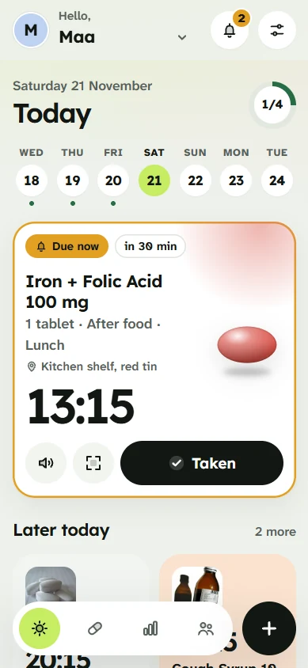
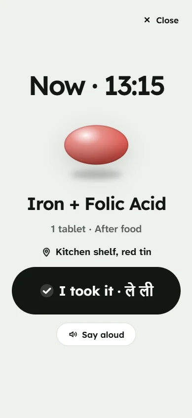
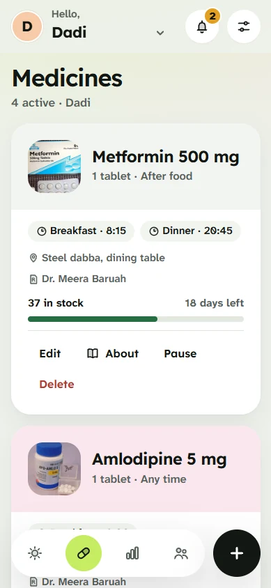
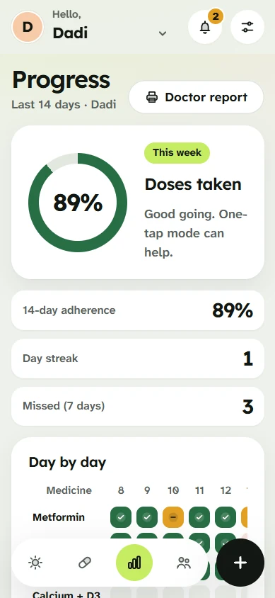

<p></p>

# Dawai Dost · दवाई दोस्त

**Medicine reminders that follow an elder's day, speak in Hindi or English, and keep the family in the loop.**
PromptWars × Code1 · PS02 *MediTrack: Smart Medicine Reminder* (Healthcare)

[](https://github.com/altropheptic/bhaskar-gu-aura/actions/workflows/ci.yml)

**Live app:** https://bhaskar-gu-aura.vercel.app

<p>
  
  
  
  
</p>

## Try it in 30 seconds

1. Open the live app and click **Get started**. There is no sign-up. Your browser gets a private account that starts with a sample family: 4 people, 18 medicines with real photos and a month of history.
2. Within about a minute, **an alarm rings for Dadi**. It chimes, says the reminder aloud and shows the pill. Tap **I took it**.
3. Tap **+**, type `Metformin 500mg 1-0-1 after food 30 days` and press **Quick fill**. The form fills itself.
4. Open the **bell** for alerts, **Progress** for the doctor report and **Family** for the WhatsApp update and caregiver link.

Every tap is saved to the database. **Log out** returns to the home page and keeps the list.

---

## 1. Problem statement alignment

PS02 asks for *a simple, accessible web app to organise, manage and track daily medication schedules* for elderly people who forget their medicines.

| PS02 asks for | How Dawai Dost does it |
|---|---|
| **Organise** every medicine | One list per elder: strip photo, strength, meal slot, where it's kept, prescribing doctor. Several elders per phone. |
| **Manage** schedules | Add in seconds from prescription shorthand (`1-0-1`, `BD`, `HS`) or a photo (Gemini). Doses attach to the elder's own meals, so changing dinner to 9:30 moves every evening dose. Pause, edit, refill tracking. |
| **Track** doses | Taken, skipped or missed, with Undo. Streak, 14-day adherence, a day-by-day grid and a printable doctor report. |
| **Remind** people who forget | Chime + spoken reminder in Hindi or English + notification + snooze. Big one-tap mode. Phone-calendar export so it rings even with the browser closed. An alerts bell keeps doses missed after a dismissed alarm. |
| **Accessible** for elders | Large type, 48–56px targets, extra-large text mode, plain words, a typeface built for low vision, voice. |
| **Families** who help | WhatsApp daily summary and a private read-only caregiver link that can be revoked. |

**Why these choices:** forgetting is the top reason older adults miss doses ([study](https://www.ncbi.nlm.nih.gov/pmc/articles/PMC6981635/)). 49% of older Indians take five or more medicines ([meta-analysis](https://www.ncbi.nlm.nih.gov/pmc/articles/PMC8173298/)). Routine and place cues beat clock alarms ([Stawarz et al.](https://discovery.ucl.ac.uk/id/eprint/1418104)).

**Safety by design:** a missed dose never says "take two now". The app says *"Do not take two doses together; ask your pharmacist."* The same dose can't be logged twice (database constraint), and two brands of one molecule (Dolo + Crocin) trigger a warning. AI only fills a form; a person always checks and saves.

## 2. Code quality

- **Small, single-purpose ES modules** in [`js/`](js) (vanilla JS, no framework). No module is over 250 lines, and each opens with a JSDoc note on *why* it exists.
  - Logic: `schedule.js` (dose maths), `routine.js` (meal-based timing), `quickEntry.js` (1-0-1 reader), `medFormData.js` (form → medicine).
  - Data: `store.js` (one interface) over `storeLocal.js` and `storeCloud.js`, with shared row rules in `storeRows.js`.
  - UI: one file per screen, plus reusable `formControls.js` and `quickAdd.js`.
- **Shared types:** [`js/types.js`](js/types.js) documents `Profile`, `Medicine`, `DoseLog` and `Dose` as JSDoc typedefs, so editors autocomplete and check them.
- **Pure logic is separate from the DOM**, which keeps it easy to test.
- **One source of truth:** views read shared state; only `state.js` actions write, so screens never disagree.
- **No duplication:** the voice sentence template (`voiceText.js`) and validation (`medSchema.js`) are shared by the browser and the `/api` functions.
- **ESLint** (recommended + `eqeqeq`, `prefer-const`, `no-unused-vars`, `no-var`): 0 issues.
- **CI** on every push: lint → tests with coverage thresholds → production build ([workflow](.github/workflows/ci.yml)).

```
api/        Vercel functions: ai.js (Gemini), tts.js (ElevenLabs), caregiver.js, _lib.js (guards)
js/         Browser modules: app, state, store*, schedule, routine, screens, dialogs, reminders, voice…
css/        One stylesheet with design tokens
tests/      128 Vitest tests: logic, API flows, screens, dialogs, the full user journey, accessibility
supabase/   schema.sql: tables, CHECK constraints, RLS policies (mirrors the applied migrations)
docs/       ARCHITECTURE.md · SECURITY.md · AI_WORKFLOW.md
```

## 3. Security

- **Private without a login.** Each browser gets a Supabase anonymous account, and **Row Level Security** on all 4 tables limits every user to their own rows. Inserts must also prove the parent profile or medicine is theirs.
- **Secrets never reach the browser.** Only public `VITE_*` values are bundled. Gemini, ElevenLabs and the Supabase secret key live in `/api` only, and are sent in headers, never in URLs.
- **Hardened API:**
  - `/api/ai` and `/api/tts` require a valid session.
  - Limits: per IP (per minute) and per account (per day), so a stolen session can't drain the AI or voice budget.
  - Every field is checked against size limits and allow-lists, and errors are generic.
  - The voice endpoint can only speak a fixed template, never free text.
  - The AI prompt treats prescriptions as untrusted data, and its output is re-validated on the server and again in the browser.
- **Caregiver links** use 24 random bytes. Only a SHA-256 hash is stored, links expire and can be revoked, and the endpoint returns the minimum data.
- **Three layers of validation:** browser, `/api` and Postgres `CHECK` constraints.
- **XSS-safe:** all dynamic text uses `textContent` (no `innerHTML`).
- **Headers:** strict CSP (self + our Supabase only), HSTS, `X-Frame-Options: DENY`, `nosniff`, COOP, CORP and a tight `Permissions-Policy`.
- **Responsible disclosure:** [`/.well-known/security.txt`](public/.well-known/security.txt).
- **Checked:** `npm audit` reports 0 vulnerabilities, and 22 tests cover the API guards and flows (bad input, missing session, prompt-injection framing, key handling, quotas). The Supabase security advisor shows only the expected anonymous-sign-in notice.

Details: [docs/SECURITY.md](docs/SECURITY.md)

## 4. Efficiency

- **Small first load:** the first screen needs **18 KB of JavaScript (gzipped)** plus ~10 KB of CSS, with no framework.
  - The Supabase library (56 KB) loads in parallel in its own chunk.
  - The medicine form, profile dialog, one-tap mode, print views, AI client and sample family load only when used, then are pre-fetched while the browser is idle.
- **Images:** screenshots are WebP (13–33 KB), the logo 40 KB. The hero image loads with high priority; the rest load lazily. User photos are shrunk in the browser to ~25 KB before saving.
- **Caching:** hashed build files are cached for a year (`immutable`), images for a week, and a service worker keeps the app shell for offline use.
- **Few network calls:**
  - A new account is set up with a few batched inserts (history in batches of 500).
  - Only 30 days of logs are read.
  - The AI uses fast "Flash Lite" models with short timeouts and falls back to the next model.
- **Close to users:** functions run in Mumbai (`bom1`), next to the Supabase project, also in Mumbai.

## 5. Testing

**128 tests in 17 files** with [Vitest](https://vitest.dev), **81% line coverage**, and minimum coverage enforced in CI. Run `npm test`, or `npm run coverage`.

| Level | What's covered |
|---|---|
| Logic | dose scheduling, due/missed windows, re-timing, adherence, streaks, refills, duplicate brands, the 1-0-1 reader, form → data, validation, voice sentences, calendar export |
| Data | local and cloud backends: normalising, the double-dose guard, Undo restoring stock, friendly errors, rollback of a failed setup, batched inserts |
| API | guards (400/401/404/429), Gemini parsing, model fallback, prompt framing, key only in headers, voice template, caregiver link lookup by hash |
| Screens | Today, Medicines, Progress, Family, alerts, one-tap mode, print views, add/edit dialogs, alarm ringing and "I took it" |
| Journey | home → Get started → every tab → bell → settings → log out → back, with Supabase unreachable (on-device fallback) |
| Accessibility | axe-core audit of 3 pages, plus a WCAG contrast check of the colour palette |

The live site was also checked end to end: account setup, Gemini parsing, ElevenLabs voice in both languages, caregiver links, API guards and phone layouts.

## 6. Accessibility

- **Audited automatically:** **0 axe-core violations** on the home page, the app with the Today screen and the family page. Every text colour pair passes **WCAG 2.2 AA (4.5:1)**, and UI borders reach 3:1. Both checks run in CI.
- **Built for older eyes and hands:** 18px base text with an extra-large mode, 48–56px tap targets, Atkinson Hyperlegible Next (a typeface designed for low-vision readers), and a big one-tap mode.
- **Not colour alone:** every status has an icon and a word (✓ Taken, ✕ Missed).
- **Keyboard and screen readers:** semantic HTML, a skip link, visible focus rings, ARIA labels on icon buttons, native `<dialog>` (focus trap, Esc to close), `role="status"` toasts and live regions. Hindi text is marked `lang="hi"`.
- **Voice:** reminders are spoken in Hindi or English for people who can't read small print.
- **Different setups:** Windows High Contrast (forced colours) keeps selected and focus states visible, `prefers-reduced-motion` is honoured, layouts work from 320px phones to desktops, and the home page reads without JavaScript.

## AI tools used

- **Google Gemini** (`/api/ai`): prescription text or photo → schedule (JSON schema, then validated on the server and in the browser), and "What is this medicine for?" in Hindi or English. Every AI feature has a non-AI fallback.
- **ElevenLabs** (`/api/tts`): natural multilingual voice for reminders. Falls back to the browser's own voice.
- **Claude Code** planned, researched, built and verified the app, using the Supabase MCP (schema, RLS, advisors) and the Vercel MCP (deploys, logs). See [docs/AI_WORKFLOW.md](docs/AI_WORKFLOW.md).

## Run locally

```bash
npm install
vercel env pull .env.local   # needs access to the Vercel project; see .env.example
npm run dev                  # app on http://localhost:5173
vercel dev                   # app + /api on http://localhost:3000
npm run check                # lint + tests with coverage + build
```

**Stack:** HTML5, CSS3, ES modules, Vite · Supabase (Postgres, RLS, anonymous auth) · Vercel (static + Node functions in Mumbai) · Gemini · ElevenLabs.

**Docs:** [Architecture](docs/ARCHITECTURE.md) · [Security](docs/SECURITY.md) · [AI workflow](docs/AI_WORKFLOW.md) · Photo credits: [public/demo/CREDITS.md](public/demo/CREDITS.md)

*Dawai Dost is a reminder and tracking tool, not medical advice.*
