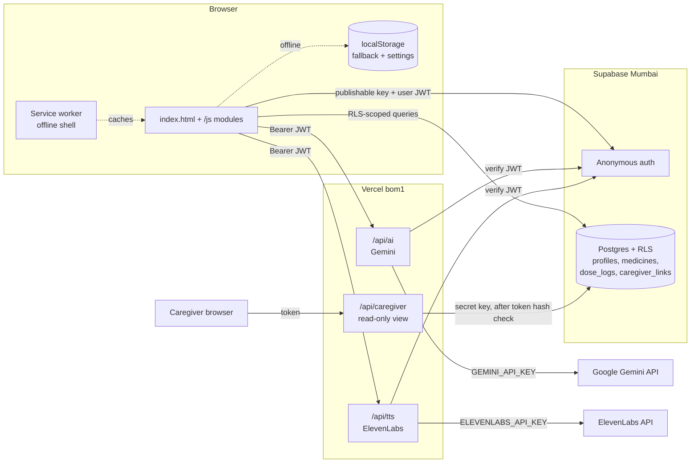

# Architecture

## Overview

Dawai Dost is a static multi-page site (vanilla ES modules, bundled by Vite) with three small Vercel Node functions. Data lives in Supabase Postgres, protected by Row Level Security. The browser never sees a secret.

## Modules (`/js`)

| Module | Responsibility |
|---|---|
| `app.js` | Boot, tabs, header, settings dialog, first-open setup (saves the sample family into a new account) |
| `state.js` | Central state + actions (load, save, log dose, undo) with subscribe/emit |
| `store.js` | One data interface with two backends: cloud (Supabase) and local (localStorage fallback), plus `importAll` for the sample family |
| `supabaseClient.js` | Browser client + silent anonymous session |
| `schedule.js` | Pure schedule maths: doses per day, status, adherence, streaks, supply, duplicates |
| `quickEntry.js` | Rule-based "1-0-1" prescription parser (offline fallback for AI) |
| `medSchema.js` | Field rules shared by the browser form **and** the server (validation + AI sanitiser) |
| `todayView.js`, `medicinesView.js`, `historyView.js`, `careView.js` | The four screens |
| `medForm.js`, `profileDialog.js` | Add/edit dialogs with validation |
| `doseActions.js` | Take / skip / undo, shared by Today, alarm and one-tap mode |
| `reminders.js` | Alarm engine: 20 s tick, chime (Web Audio), voice, notification, snooze |
| `oneTap.js` | Full-screen one-button mode |
| `voice.js`, `voiceText.js` | ElevenLabs via `/api/tts` with browser speech fallback; shared sentence template |
| `ai.js` | Client for `/api/ai` with photo downscaling |
| `ics.js`, `share.js`, `reports.js` | Calendar export, WhatsApp + caregiver links, print views |
| `caregiver.js` | The read-only family page |
| `notifications.js` | The bell: due and missed doses, refills and reminder setup in one sheet |
| `routine.js` | Meal-based timing: slots, food offsets, re-timing when the routine changes |
| `ui.js`, `settings.js` | Safe DOM helpers (`textContent` only), banners, toasts; text size and voice preferences |

## Key flows

**Logging a dose:** the "I took it" button calls `doseActions.takeOrSkip`, which calls `state.logDose`, then `store.addLog` (INSERT; the `UNIQUE(medicine_id, scheduled_for)` constraint rejects duplicates) and lowers the stock. State reloads, every screen re-renders, and a toast offers Undo.

**Alarm:** `reminders.tick()` runs every 20 s. It takes today's doses at or after their time that are unlogged, not already fired and not snoozed, and calls `ring()`. That opens the dialog, plays the chime, speaks via `voice.js`, and shows a notification if the tab is hidden.

**AI entry:**
1. Text or photo goes to `/api/ai`.
2. The server verifies the JWT and validates the input.
3. Gemini is called with a JSON response schema, and its output goes through `sanitizeAiMedicine` on the server.
4. The browser sanitises it again, and the result fills the form.
5. A person reviews it and saves.

**Caregiver link:**
1. The browser makes 24 random bytes and keeps them as a base64url token.
2. It stores only `sha256(token)` in `caregiver_links` (an RLS insert).
3. The family opens `/caregiver.html?t=…`.
4. `/api/caregiver` hashes the token, checks expiry and revocation, and returns a minimal payload.

## Data model

See [`supabase/schema.sql`](../supabase/schema.sql): `profiles` → `medicines` → `dose_logs`, plus `caregiver_links`. Every table has `user_id default auth.uid()` and four RLS policies.

## Quality gates

- `npm run lint`: ESLint (recommended + `eqeqeq`, `prefer-const`, `no-unused-vars`).
- `npm test`: Vitest unit tests for the pure modules (`schedule`, `routine`, `quickEntry`, `medSchema`, `voiceText`, `demoData`) and the `/api` guards.
- `npm run build`: Vite production build.
- GitHub Actions runs all three on every push ([.github/workflows/ci.yml](../.github/workflows/ci.yml)).

