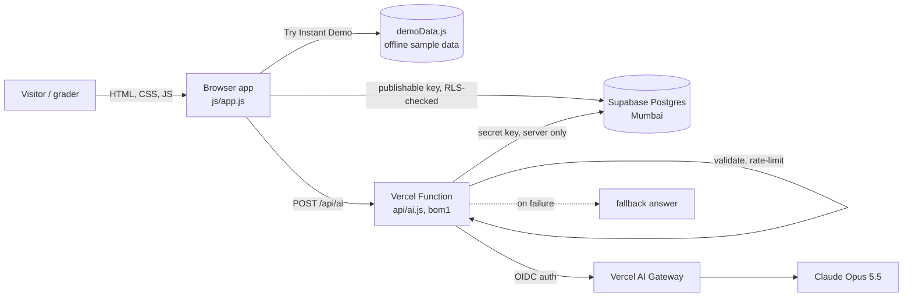

# Architecture

> Skeleton: completed with the real feature flow at the end of the hackathon.

## Overview

| Layer | Technology | Responsibility |
| --- | --- | --- |
| Frontend | Vanilla HTML5, CSS3, ES modules (bundled by Vite) | UI, input validation for UX, safe rendering |
| Server | Vercel Functions in `/api` (Node.js, region `bom1` Mumbai) | AI calls, privileged DB work, validation, rate limiting |
| AI | Vercel AI Gateway → `anthropic/claude-opus-5.5` (reasoning: high) | AI features, authenticated with Vercel OIDC |
| Data | Supabase Postgres (ap-south-1 Mumbai) with Row Level Security | Storage and access rules |
| Hosting | Vercel, auto-deploy from GitHub `main` | HTTPS, security headers, previews |

## Data flow

## Module map

| File | Purpose |
| --- | --- |
| `js/app.js` | Entry point; wires events to services |
| `js/ui.js` | Safe DOM rendering, banners, loading and empty states |
| `js/demoData.js` | Offline demo dataset and AI fallback |
| `js/supabaseClient.js` | Browser Supabase client (publishable key) |
| `js/aiService.js` | Browser → `/api/ai` with timeout and fallback |
| `api/ai.js` | AI route: validation, rate limit, AI Gateway call |
| `api/health.js` | Health check: function + database reachability |
| `supabase/schema.sql` | Tables and RLS policies |

## Feature flows

_To be documented after the build._
